# Credit Card Default Prediction — Project Results Record

> **Purpose:** Master reference for the research report and presentation. Keep exploratory results separate from the revised validation results and final test results.
>
> **Dataset:** UCI Default of Credit Card Clients; 30,000 customers, Taiwanese data from 2005.
>
> **Important:** The links to images below assume you copy/rename the corresponding image files into `results/plots/` inside the project folder. If your filenames differ, edit the paths in this Markdown file.

## 1. Problem statement

Predict whether a credit-card customer will default on payment next month (`default = 1`) or not (`default = 0`). The project compares standard logistic regression with Bayesian logistic regression and examines model evaluation, risk segmentation, PCA, feature contribution, and probability calibration.

## 2. Dataset and initial EDA

- Original dataset shape: **30,000 rows × 25 columns** (24 predictors plus the target).
- Missing values: **0**.
- `ID` is an identifier and is excluded from predictors.
- Target distribution:
  - No default (`0`): **23,364 (77.88%)**
  - Default (`1`): **6,636 (22.12%)**
- Gender coding in the dataset: `SEX=1`: 11,888; `SEX=2`: 18,112.
- Original education counts: `0`: 14; `1`: 10,585; `2`: 14,030; `3`: 4,917; `4`: 123; `5`: 280; `6`: 51.
- Original marriage counts: `0`: 54; `1`: 13,659; `2`: 15,964; `3`: 323.
- `LIMIT_BAL`: mean NT$167,484; median NT$140,000; minimum NT$10,000; maximum NT$1,000,000.
- `AGE`: mean 35.49 years; median 34; range 21–79 years.

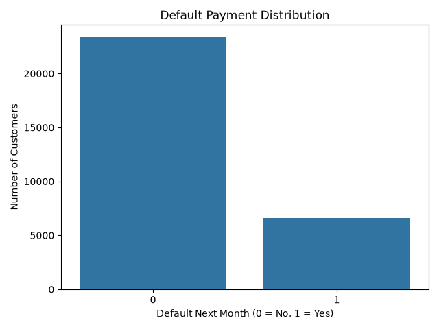

## 3. Cleaning and preprocessing decisions

- Removed `ID` from model predictors.
- Education modelling choice: pool original codes `0`, `4`, `5`, and `6` into **Other/Unknown** (represented as code `4`); retain `1`, `2`, and `3` separately.
- Marriage modelling choice: pool original codes `0` and `3` into **Other/Unknown** (represented as code `3`); retain `1` and `2` separately.
- These category groupings are modelling choices for interpretability; they do **not** claim the original codes have identical meanings.
- Numeric features are standardized with `StandardScaler`; categorical features are one-hot encoded using `OneHotEncoder(drop="first", handle_unknown="ignore")` within a `ColumnTransformer`.
- The preprocessor is fitted on the training set only, then applied to validation and test sets.
- After pooling, education counts are: `1`: 10,585; `2`: 14,030; `3`: 4,917; `4` (Other/Unknown): 468.
- After pooling, marriage counts are: `1`: 13,659; `2`: 15,964; `3` (Other/Unknown): 377.
- Duplicate investigation: 35 repeated rows across non-ID columns were reported. The profile diagnostic reported 108 rows belonging to repeated predictor profiles, across 31 profiles with a single target label and 21 profiles with conflicting target labels. All records were retained because identical recorded predictors alone do not prove accidental duplication.

## 4. Final data split

A stratified 70/15/15 split was used with `random_state=42`.

| Split | Rows | Default rate |
|---|---:|---:|
| Training | 21,000 | 22.12% |
| Validation | 4,500 | 22.11% |
| Final test | 4,500 | 22.13% |

- Original predictors after dropping `ID`: **23**.
- Processed training and validation feature matrices: **26 columns**.
- Training data fit the preprocessor and models; validation data were used for model/threshold decisions; the final test set was reserved for final evaluation.

## 5. Standard logistic regression — validation results

The classification threshold was selected on validation data to maximize F1-score. Selected threshold: **0.28**.

| Metric | Validation result |
|---|---:|
| Accuracy | 0.792 |
| Precision | 0.533 |
| Recall | 0.486 |
| F1-score | 0.509 |
| ROC-AUC | 0.714 |
| Average Precision | 0.503 |

Validation confusion matrix (rows = actual, columns = predicted):

|  | Predicted no default | Predicted default |
|---|---:|---:|
| Actual no default | 3,081 | 424 |
| Actual default | 511 | 484 |

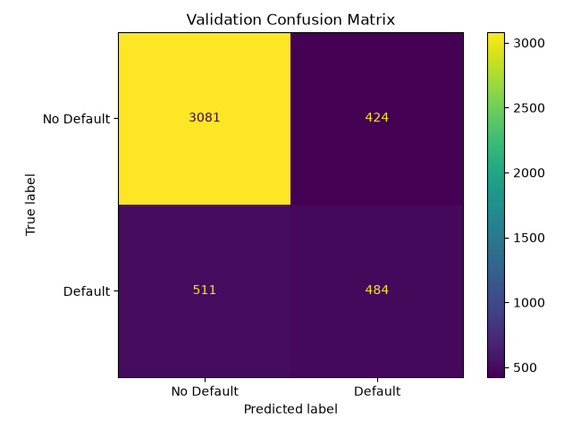

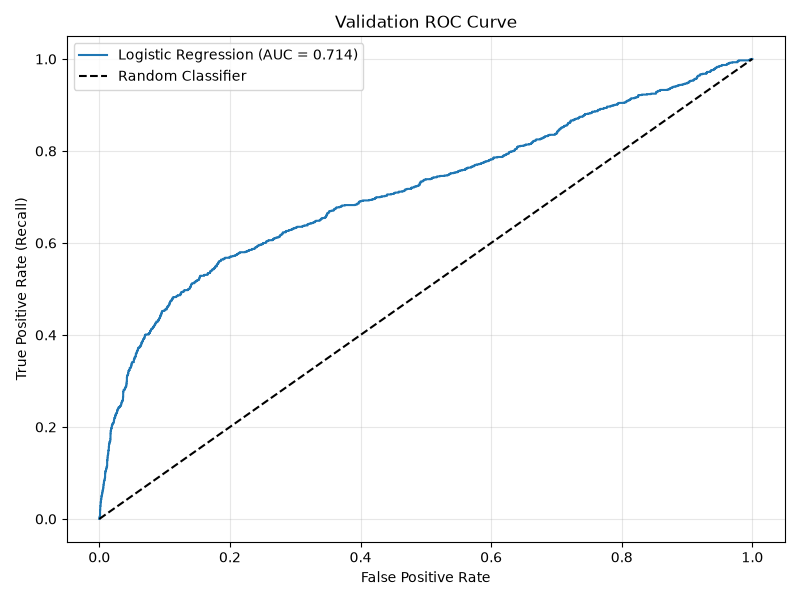

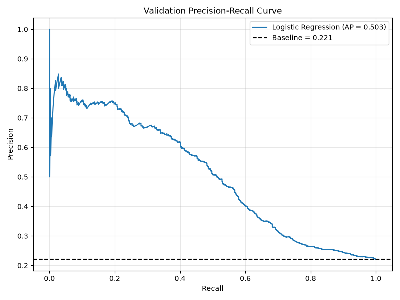

### Coefficients

Largest positive coefficients included `PAY_0` (+0.654), `BILL_AMT3` (+0.109), `PAY_2` (+0.102), and `PAY_3` (+0.085). The largest negative coefficient was `EDUCATION_4` (−1.134), followed by `BILL_AMT1` (−0.327) and `PAY_AMT2` (−0.253).

Coefficients describe changes in log-odds, holding other variables constant; they are not causal effects or a universal feature-importance ranking.

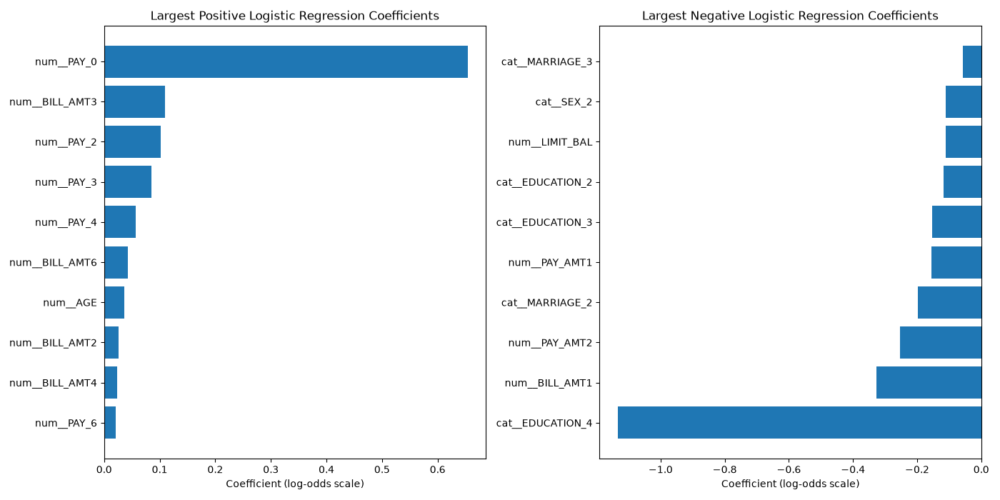

## 6. PCA and risk segmentation — validation data

PCA was fitted on the processed training data and used to project validation customers into two dimensions.

- PC1 explained **31.39%** of variance.
- PC2 explained **19.60%** of variance.
- PC1 and PC2 together explained **50.99%**.
- **12 components** were needed to explain at least 90% of variance.
- The PCA scatter plot shows substantial overlap between the actual default and no-default classes; PCA is used for visualization, not as the classifier.

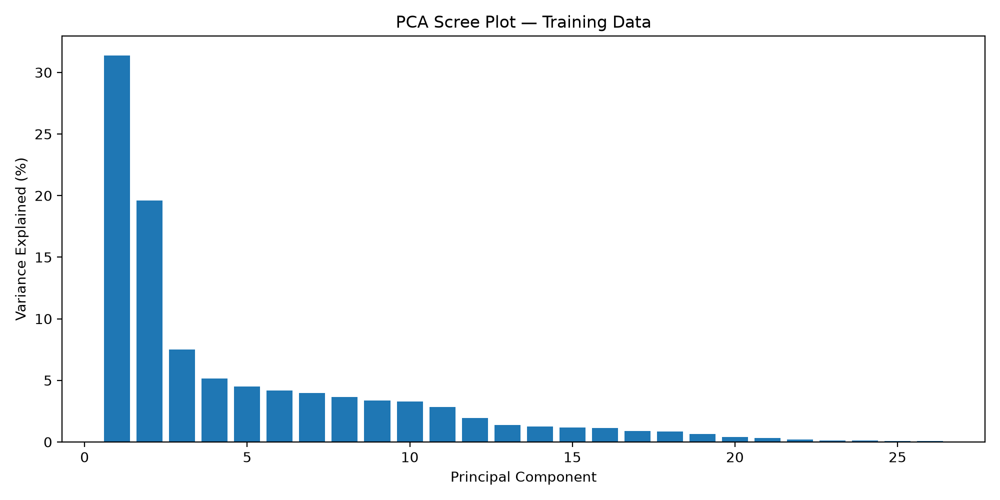

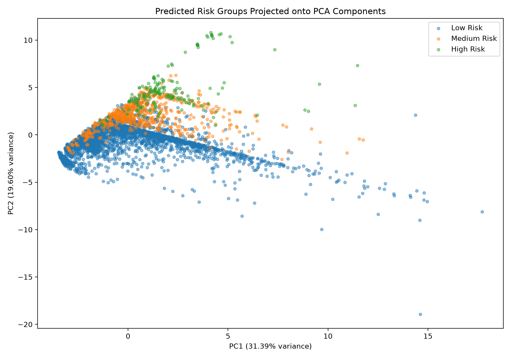

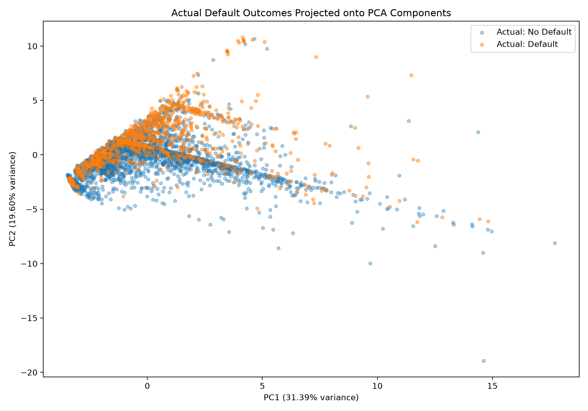

Risk bands are **project-defined**, not official banking policy: Low < 0.30; Medium 0.30 to < 0.60; High ≥ 0.60.

| Predicted risk group | Customers | Actual defaults | Actual default rate | Average predicted risk |
|---|---:|---:|---:|---:|
| Low | 3,700 | 545 | 14.7% | 16.3% |
| Medium | 622 | 317 | 51.0% | 43.9% |
| High | 178 | 133 | 74.7% | 70.0% |

Observed default rates increase substantially across the risk groups, suggesting the scores distinguish groups with different risk levels. The medium and high groups' observed rates exceed their average predicted risks.

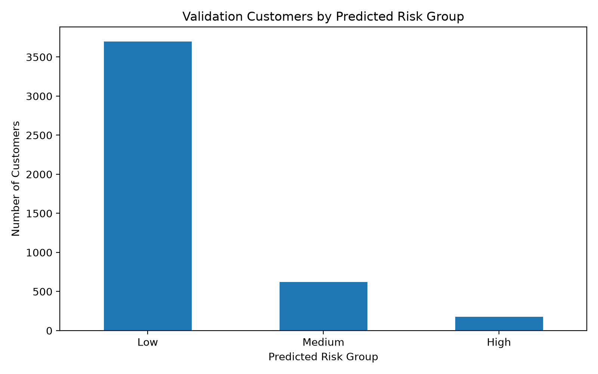

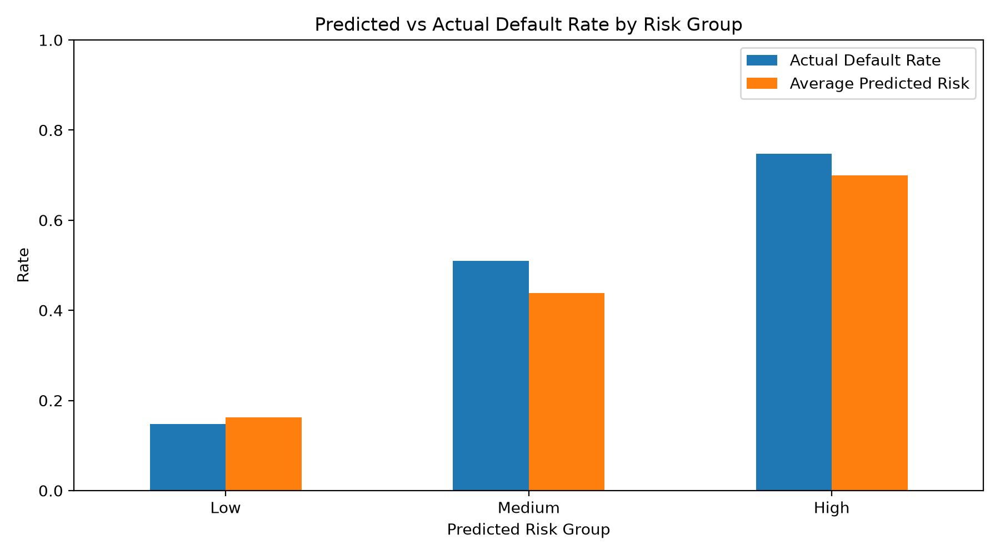

## 7. Bayesian logistic regression — validation analysis

- PyMC Bayesian logistic regression was fitted on the same 21,000 training customers.
- Priors: Normal(0, 1) for feature coefficients; Normal(0, 1.5) for the intercept.
- Sampling: 4 chains, 1,000 tuning iterations and 1,000 posterior draws per chain.
- Latest run reported **0 divergences** and maximum **R-hat = 1.003**. These are encouraging sampling diagnostics, not proof that the model is correct.
- Threshold selected on validation data to maximize F1-score: **0.29**.

| Metric | Bayesian validation result |
|---|---:|
| Accuracy | 0.799 |
| Precision | 0.553 |
| Recall | 0.470 |
| F1-score | 0.508 |
| ROC-AUC | 0.714 |
| Average Precision | 0.503 |

Examples from posterior coefficient estimates:

- `PAY_0`: mean 0.654; 95% credible interval [0.606, 0.701].
- `LIMIT_BAL`: mean −0.110; 95% credible interval [−0.160, −0.062].
- `AGE`: mean 0.036; 95% credible interval [−0.005, 0.076], which crosses zero.
- `EDUCATION_4`: mean −1.159; 95% credible interval [−1.600, −0.754]. Interpret this pooled category cautiously.

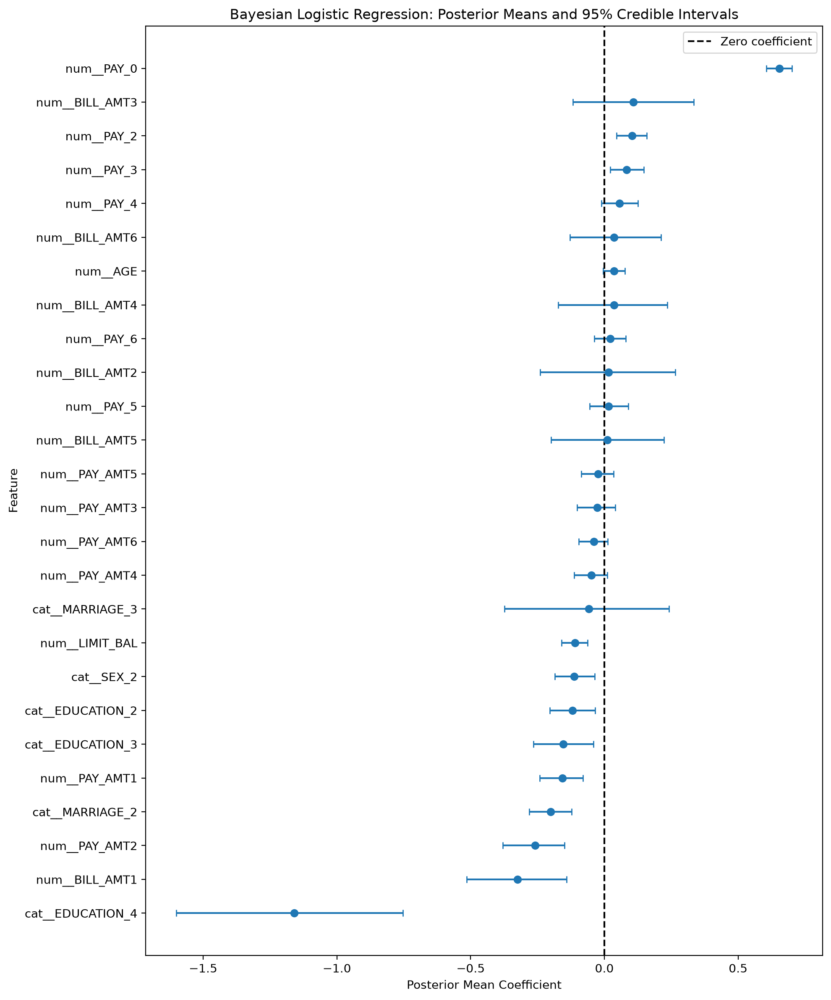

## 8. Model comparison — validation data

| Metric | Standard logistic regression | Bayesian logistic regression |
|---|---:|---:|
| Threshold | 0.28 | 0.29 |
| Accuracy | 0.792 | 0.799 |
| Precision | 0.533 | 0.553 |
| Recall | 0.486 | 0.470 |
| F1-score | 0.509 | 0.508 |
| ROC-AUC | 0.714 | 0.714 |
| Average Precision | 0.503 | 0.503 |

The models have very similar validation performance. Standard logistic regression has slightly higher recall and F1-score; Bayesian logistic regression has slightly higher accuracy and precision at the selected thresholds. These small differences do not establish that either model is superior.

## 9. Validation calibration and permutation importance

### Brier scores

| Model | Validation Brier score |
|---|---:|
| Standard logistic regression | 0.1458 |
| Bayesian logistic regression | 0.1458 |
| Constant-rate baseline | 0.1722 |

Lower Brier scores are better. Both models outperform the constant-rate baseline on this metric, while their calibration curves almost overlap. Calibration is not perfect and should be interpreted alongside discrimination and the calibration plot.

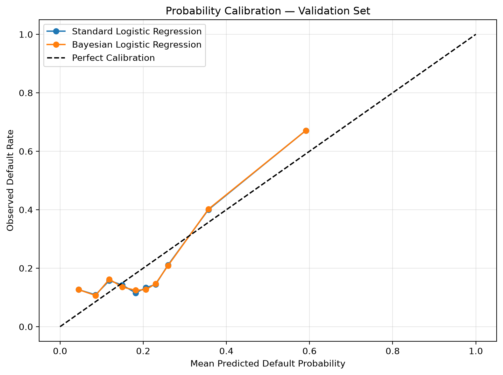

### Permutation importance

Importance is measured as the decrease in validation Average Precision after shuffling one original feature. Results are from the validation set, with 10 shuffles per feature.

| Feature | Mean decrease in Average Precision | Standard deviation |
|---|---:|---:|
| `PAY_0` | 0.2056 | 0.0071 |
| `BILL_AMT1` | 0.0225 | 0.0034 |
| `MARRIAGE` | 0.0052 | 0.0021 |
| `BILL_AMT3` | 0.0050 | 0.0017 |
| `PAY_AMT2` | 0.0040 | 0.0019 |
| `LIMIT_BAL` | 0.0039 | 0.0014 |
| `PAY_3` | 0.0039 | 0.0010 |
| `EDUCATION` | 0.0033 | 0.0017 |

`PAY_0` is the dominant feature by this validation measure. Permutation importance indicates predictive usefulness, not causation; correlated features may share or mask each other's importance.

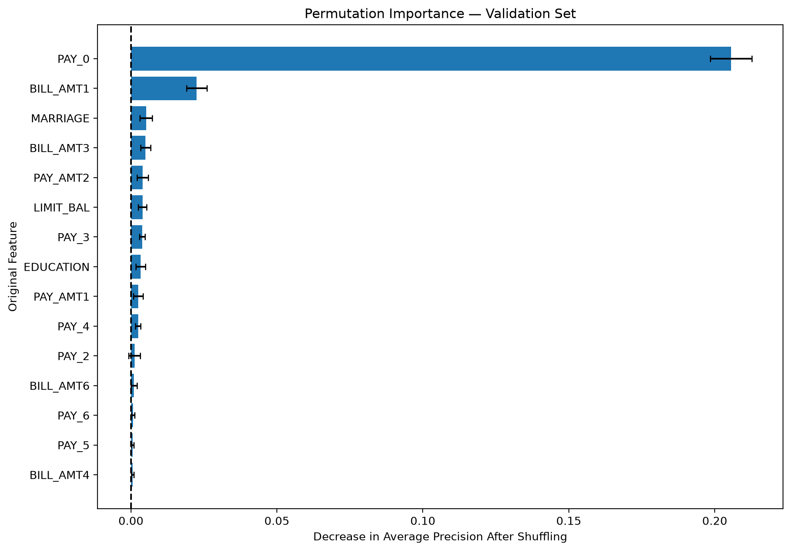

## 10. Final held-out test results

These results were produced using the locked thresholds selected from validation data. Do not use the test results to tune the model or change the thresholds.

| Metric | Standard logistic regression | Bayesian logistic regression |
|---|---:|---:|
| Threshold | 0.28 | 0.29 |
| Accuracy | 0.7876 | 0.7971 |
| Precision | 0.5215 | 0.5481 |
| Recall | 0.4869 | 0.4749 |
| F1-score | 0.5036 | 0.5089 |
| ROC-AUC | 0.7187 | 0.7189 |
| Average Precision | 0.4949 | 0.4949 |
| Brier score | 0.1464 | 0.1463 |

Final test confusion matrices (rows = actual, columns = predicted):

**Standard logistic regression**

|  | Predicted no default | Predicted default |
|---|---:|---:|
| Actual no default | 3,059 | 445 |
| Actual default | 511 | 485 |

**Bayesian logistic regression**

|  | Predicted no default | Predicted default |
|---|---:|---:|
| Actual no default | 3,114 | 390 |
| Actual default | 523 | 473 |

- Majority-class baseline accuracy (always predict no default): **77.87%**.
- Training-rate constant-probability baseline Brier score: **0.1723**.

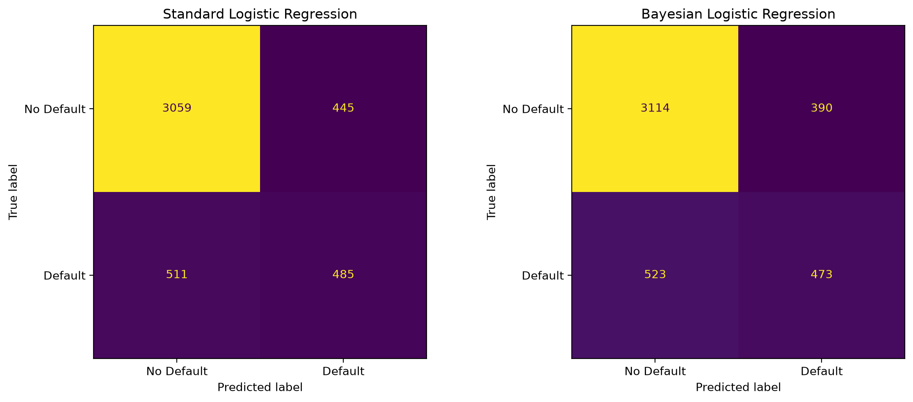

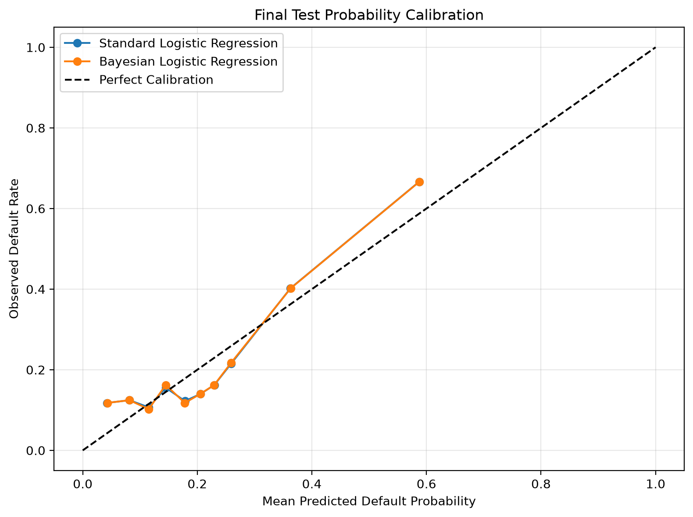

### Final interpretation

The two models have nearly identical test discrimination and Average Precision. Bayesian logistic regression has slightly higher accuracy, precision, F1-score and a marginally lower Brier score, while standard logistic regression has slightly higher recall. The differences are small and do not establish clear superiority. Both models miss roughly half of actual defaulters at the selected thresholds.

## 11. Research question and takeaway

**Research question:** Can Bayesian logistic regression provide useful uncertainty estimates while maintaining comparable predictive performance to standard logistic regression for credit-card default prediction?

**Takeaway:** Standard logistic regression provides useful default-risk predictions. Bayesian logistic regression adds posterior distributions and credible intervals for coefficients, allowing uncertainty about learned associations to be expressed. In this experiment, Bayesian modelling maintained comparable predictive performance but did not demonstrate a meaningful predictive advantage.

## 12. Limitations

- The dataset represents Taiwanese credit-card clients and payment behaviour from 2005; it may not generalize to today's banking populations.
- The target is imbalanced (about 22.1% defaults), so accuracy alone is insufficient.
- Risk cutoffs of 0.30 and 0.60 are project-defined examples, not banking policy.
- Thresholds were selected by validation F1-score, not by a bank-specific cost function.
- Calibration is imperfect; predicted probabilities should not automatically be treated as reliable real-world default probabilities.
- The 35 repeated rows and repeated predictor profiles were retained because the available evidence did not prove that they were accidental duplicate records.
- The final test split was reserved from the revised pipeline, but earlier exploration of this dataset means it should not be described as a completely independent external validation.
- Bayesian sampling diagnostics were good, but they do not establish that priors, model assumptions or predictions are universally correct.